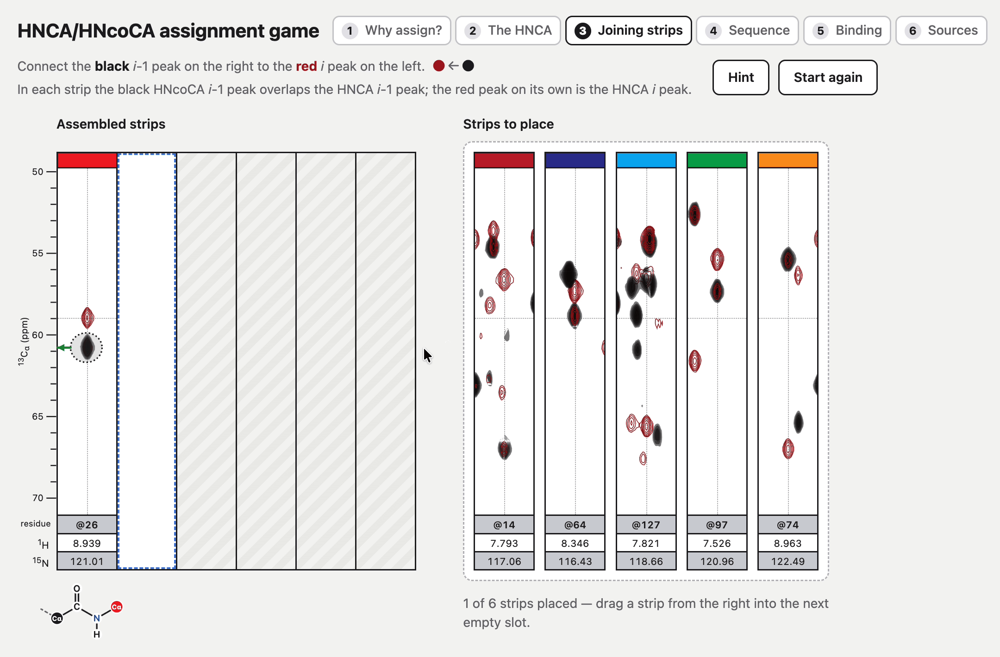

# The Strip Plot Game

https://github.com/user-attachments/assets/cb3b2106-4689-42ec-ae59-e34b62e9912e

## The online interactive version

Originally the Strip plot game was a simple set of A simple set of picture files that could 
be cut out and played with. See the end of this document for the original downloads. However,
it's now been updated to provide a 3D interactive walkthrough of what triple resonance 
spectra are, how they might be used, what 3D spectra are, with examples taken from the 
DDX3 - K7R NMR data set measured by Kalverda and Thompson.

The on line interactive versions is [here](https://varioustoxins.github.io/Strip-Plot-Game/)

> if you like it please give it a star

## The Desktop Version

The original version of the 3D HNCA/HNcoCA strip game alignment game that uses bits of paper 
can be shuffled around on a table is [here](https://github.com/varioustoxins/Strip-Plot-Game/blob/main/all-files.zip). If you use it please give it a star!

## Licensing
© G. S. Thompson. The Strip Plot Game (the online game, its pictures, the tabletop sheets and the tools) is
licensed under [Creative Commons Attribution-NonCommercial-ShareAlike 4.0](https://creativecommons.org/licenses/by-nc-sa/4.0/);
the full text is in [LICENSE](LICENSE).

- **You may** use, copy, print, share and adapt it for free, for teaching or any other non-commercial purpose.
- **You must** credit G. S. Thompson and share any adapted versions under the same licence.
- **You may not** sell it or use it commercially without permission: for commercial use, please get in touch.

The NMR data come from [BMRB 15740](https://bmrb.io/data_library/summary/index.php?bmrbId=15740) and the structures
from [PDB 2K36](https://www.rcsb.org/structure/2K36) and [PDB 3JRV](https://www.rcsb.org/structure/3JRV); the shift
changes are from Kalverda *et al.* (2009) *J. Mol. Biol.* 385, 843–853,
[doi:10.1016/j.jmb.2008.09.048](https://doi.org/10.1016/j.jmb.2008.09.048). These are used with citation and are not
covered by this licence. Full references are in step 6 of the online game. Some data on this site such as bmrb and 
PDB files is not copytighted by the owner and retains the licenses of the source sites e.g.g the PDB, BMRB etc

## Original Data

The original data is from a paper by Thompson and Kalverda, details are below.

- A. P. Kalverda, G. S. Thompson, A. Vogel, M. Schröder, A. G. Bowie, A. R. Khan and S. W. Homans (2009).
  Poxvirus K7 protein adopts a Bcl-2 fold: biochemical mapping of its interactions with human DEAD box RNA helicase
  DDX3. *J. Mol. Biol.* **385**, 843–853. [doi:10.1016/j.jmb.2008.09.048](https://doi.org/10.1016/j.jmb.2008.09.048)
- The assignment (backbone and side-chain 1H, 13C and 15N chemical shifts) of K7 are 
  at: [BMRB 15740](https://bmrb.io/data_library/summary/index.php?bmrbId=15740),
  [doi:10.13018/BMR15740](https://doi.org/10.13018/BMR15740). Tis is the source of the  HSQC, strips and sequence in 
  the game.
- The NMR structure of K7 is n the PDB: [PDB 2K36](https://www.rcsb.org/structure/2K36),
  [doi:10.2210/pdb2K36/pdb](https://doi.org/10.2210/pdb2K36/pdb).

The crystal structure of the k7-DDX3 complex was measured by S. Oda, M. Schröder and A. R. Khan:

- S. Oda, M. Schröder and A. R. Khan (2009). Structural basis for targeting of human RNA helicase DDX3 by poxvirus
  protein K7. *Structure* **17**, 1528–1537. [doi:10.1016/j.str.2009.09.005](https://doi.org/10.1016/j.str.2009.09.005)
- The structure of K7 with the DDX3 peptide: [PDB 3JRV](https://www.rcsb.org/structure/3JRV).
